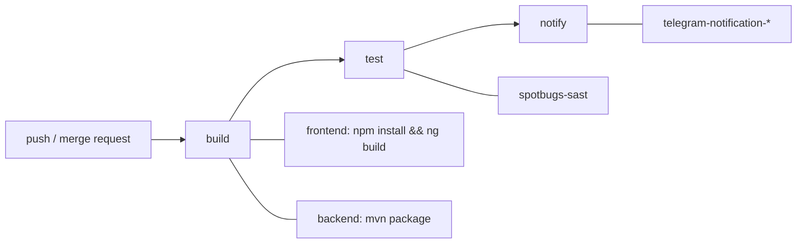

# Sausage Store — учебный проект по CI/CD


Проект выполнен в рамках курса **DevOps** (Яндекс Практикум), блок **CI/CD**.
«Сосисочная у дома» — демонстрационный интернет-магазин, вокруг которого
собран пайплайн непрерывной интеграции: сборка, статический анализ кода и
уведомления о результате.

## Зачем этот репозиторий

Бизнес-логика здесь намеренно простая: каталог товаров, корзина, оформление
заказа. Главная ценность проекта — **CI/CD-обвязка** вокруг приложения.

**CI/CD (Continuous Integration / Continuous Delivery)** — практика, при которой
каждое изменение кода автоматически собирается и проверяется. Разработчик
делает `git push`, сервер сам поднимает окружение, собирает проект, запускает
проверки, публикует артефакты и уведомляет команду. Ручные «собери у себя и
залей на сервер» из процесса уходят.

В этом проекте цикл реализован на self-hosted **GitLab CE** + **gitlab-runner**
(docker-executor): описание пайплайна лежит в `.gitlab-ci.yml` в корне
репозитория и разнесено по каталогам `backend/` и `frontend/`.

## Технологии

| Слой | Стек |
|---|---|
| Frontend | TypeScript, Angular 6, Bootstrap |
| Backend | Java 16, Spring Boot 2.5, Spring Data JPA |
| База данных | H2 (in-memory) |
| CI/CD | GitLab CE, gitlab-runner, GitLab SAST |
| Лицензия | MIT |

## Пайплайн



Стадии объявлены в корневом `.gitlab-ci.yml`, джобы — в `backend/.gitlab-ci.yml`
и `frontend/.gitlab-ci.yml`, плюс подключён шаблон `Security/SAST.gitlab-ci.yml`.

| Джоба | Стадия | Образ | Что делает |
|---|---|---|---|
| `build-backend-code-job` | build | `maven:3.9-eclipse-temurin-17` | `mvn package`, артефакт `backend/target/`, кэш `.m2/repository` |
| `build-frontend-code-job` | build | `node:10` | `npm install` + `npm run build`, артефакт `frontend/dist/frontend` |
| `spotbugs-sast` | test | SAST-образ GitLab | статический анализ Java (`COMPILE: false`) |
| `telegram-notification-backend` | notify | `curlimages/curl` | забирает артефакт бэкенда |
| `telegram-notification-frontend` | notify | `curlimages/curl` | забирает артефакт фронтенда |

Особенности:

- джобы сборки запускаются только при изменениях в своём каталоге
  (`rules: changes:`), чтобы не гонять лишнее;
- уведомления срабатывают по сообщению коммита с текстом `send notification`;
- сборка бэкенда сразу прогоняет интеграционные тесты (`mvn package` без
  `-DskipTests`) — они поднимают приложение на H2 и проверяют `/api/products`
  и `/api/orders`.

## Структура

```
.
├── .gitlab-ci.yml          # stages, include backend/frontend, SAST
├── backend/
│   ├── .gitlab-ci.yml      # сборка, spotbugs-sast, уведомление
│   ├── pom.xml
│   └── src/                # Spring Boot: контроллеры, сервисы, модели
└── frontend/
    ├── .gitlab-ci.yml      # сборка, уведомление
    ├── package.json
    └── src/app/ecommerce/  # компоненты витрины, корзины, заказов
```

## Запуск локально

### Backend

```bash
cd backend
mvn package
java -jar target/sausage-store-0.0.1-SNAPSHOT.jar
```

### Frontend

```bash
cd frontend
npm install
npm run build
npx http-server ./dist/frontend/ -p 80 --proxy http://localhost:8080
```

Затем открыть [http://localhost](http://localhost).

## Следующие шаги

- unit-тесты фронтенда в пайплайне (сейчас спеки в `src/**/*.spec.ts` — заготовки,
  сгенерированные `ng new`, и в текущем виде не проходят);
- e2e-смоук на сценарий «каталог → корзина → оплата»;
- сборка Docker-образов (nginx + jar) и стадия деплоя;
- кэширование зависимостей фронтенда и `npm ci` вместо `npm install` для
  воспроизводимых сборок.
